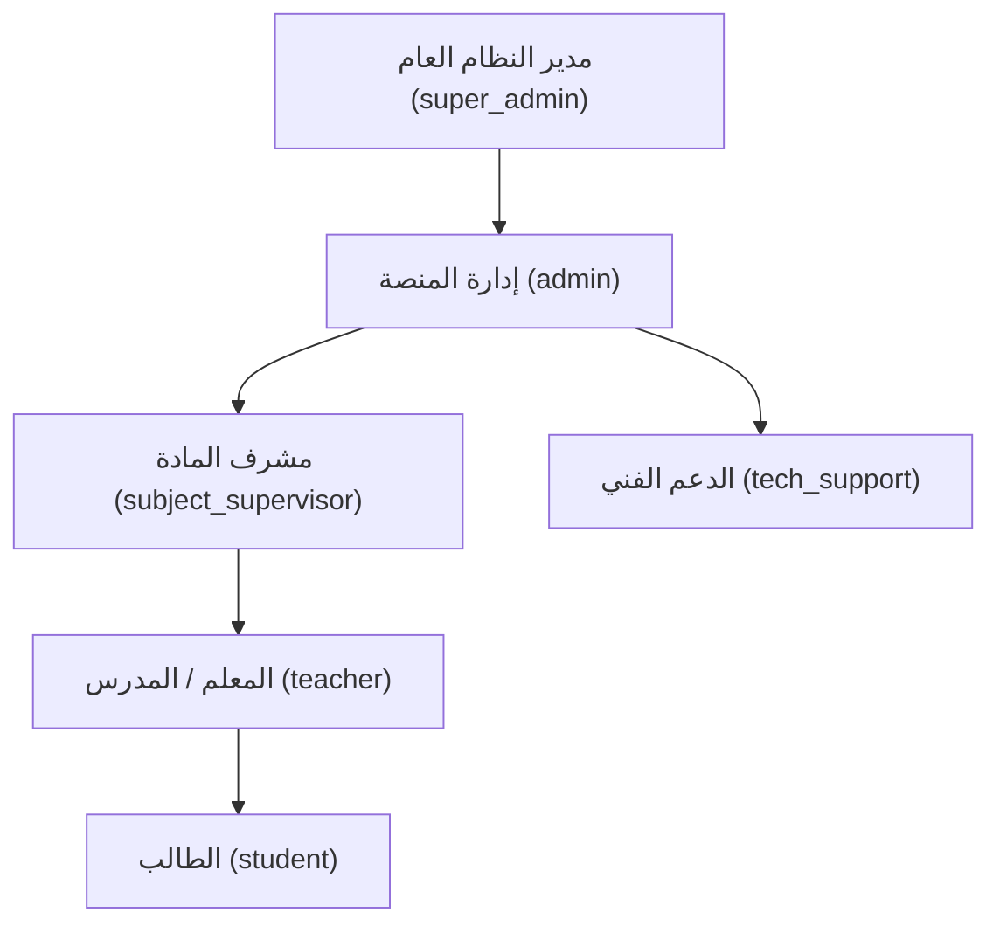
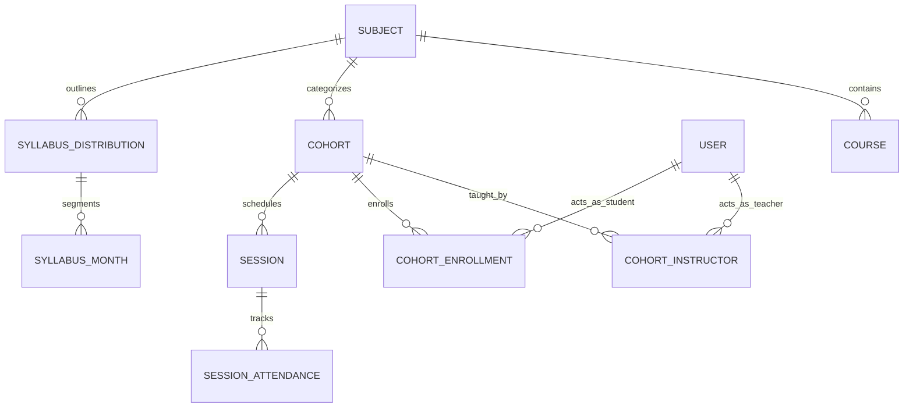
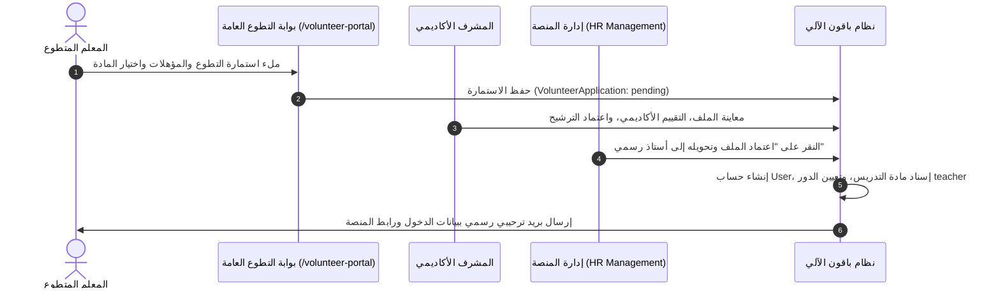

# 🌿 حوصلة المنصة والدليل المعماري الشامل للفريق المطور
### منصة باقون التعليمية — Baaqoon Educational Platform
> **وثيقة مرجعية تقنية ومعمارية للمطورين ومهندسي النظام**  
> *تاريخ التحديث: أكتوبر 2026*

---

## 1. سياق ورسالة المنصة (Mission & Educational Context)

**منصة باقون التعليمية** هي مبادرة وطنية وإنسانية وتطوعية رائدة انطلقت لدعم وإسناد طلبة فلسطين عموماً وقطاع غزة خصوصاً، لضمان استمرار حقهم الإنساني في التعليم في ظل الظروف الاستثنائية وانقطاع المدارس.

### الفئات المستهدفة:
1. **طلبة الثانوية العامة (التوجيهي الفلسطيني):**
   - الفرع العلمي (الفيزياء، الكيمياء، الأحياء، الرياضيات، اللغة العربية، اللغة الإنجليزية، التربية الإسلامية).
   - الفرع الأدبي (التاريخ، الجغرافيا، الدراسات الجغرافية، الرياضيات الأدبية، اللغات).
   - الفرع الشرعي / الأزهري (العلوم الشرعية، الفقه، التفسير والحديث، النحو والصرف).
2. **الصفوف الانتقالية:** الصف العاشر والحادي عشر.
3. **الكادر الأكاديمي المتطوع:** معلمون ومشرفون متطوعون من مختلف أرجاء الوطن العربي ودول الاغتراب.

### المحددات الميدانية التي يجب مراعاتها دائماً أثناء التطوير:
* **ضعف وانقطاع شبكات الإنترنت والكهرباء:** واجهات خفيفة، استهلاك بيانات منخفض، ودعم أوقات الاستجابة الطويلة (`Retry Mechanisms`).
* **الاعتماد على الهواتف والأجهزة اللوحية (Surface/Mobiles):** تصميم متجاوب فائق الدقة يبدأ من الشاشات الصغيرة (`Mobile-First Responsive Design`).
* **التسجيل المرن:** دعم تسجيل الدخول برقم الهاتف الدولي (واتساب) أو البريد الإلكتروني.

---

## 2. المعمارية التقنية وحزمة الأدوات (Tech Stack & Architecture)

تعتمد المنصة نمط **المستودع الموحد (Monorepo)** المنظم في حزمتين رئيسيتين:

```
baaqoon/
├── packages/
│   ├── frontend/        # تطبيق الويب التفاعلي (React 18 + Vite)
│   └── backend/         # خادم الخدمات وواجهات البرمجة (NestJS 10)
├── scratch/             # سكريبتات الفحص والتشخيص وقواعد البيانات
└── package.json         # إدارة الاعتماديات المشتركة
```

### البنية التقنية (Tech Stack):

| الطبقة (Layer) | التقنيات المستخدمة | الدور الوظيفي |
| :--- | :--- | :--- |
| **Frontend** | React 18, Vite 5, TypeScript | واجهة المستخدم التفاعلية ذات الأداء العالي |
| **Styling & Icons** | Tailwind CSS, Lucide Icons | تصميم نقي بهوية باقون الرسمية وأيقونات متجهة خفيفة |
| **State & Routing** | Zustand, React Router 6 | إدارة الحالة المشتركة والتنقل بين المسارات المحمية |
| **Internationalization** | i18next (ar / en) | دعم أصيل للغة العربية باتجاه RTL والإنجليزية |
| **Backend Framework** | NestJS 10, TypeScript | معمارية معيارية (Controllers, Services, Modules) |
| **Database & ORM** | PostgreSQL (Supabase), Prisma ORM 5.22 | قاعدة بيانات علائقية ونمذجة قوية للمخططات |
| **Authentication** | JWT, Passport, Bcrypt | مصادقة آمنة مع تجديد الجلسات والصلاحيات |
| **Mail Delivery** | Google Apps Script Relay + Nodemailer | بوابة تجاوز حجب منافذ SMTP وضمان وصول الإشعارات |
| **Cloud Hosting** | Vercel (Frontend), Render (Backend) | استضافة سحابية مع نشر مستمر وتلقائي (`CI/CD`) |

---

## 3. الهيكلية المعمارية لمسار البيانات والوحدات

```mermaid
flowchart TD
    Client["متصفح المستخدم (طالب / معلم / مشرف / مدير)"]
    Vercel["Frontend (Vercel CDN)"]
    Render["Backend API (NestJS / Render)"]
    DB[("PostgreSQL (Supabase Pooler)")]
    GAS["Google Apps Script (Mail Relay)"]

    Client -->|HTTPS / REST API| Vercel
    Vercel -->|JSON API / JWT| Render
    Render -->|Prisma ORM (Session/Tx)| DB
    Render -->|Async Webhook| GAS
    GAS -->|Direct Delivery| Mailbox["صندوق بريد المستخدم"]
```

---

## 4. نموذج الأدوار والصلاحيات (RBAC & Multi-Role Model)

تعتمد المنصة نظاماً مرناً للأدوار (`UserRole` Enum):



### ميزات الصلاحيات المتقدمة:
1. **نظام الدور المزدوج (`Dual-Role: Teacher & Supervisor`):**
   * يمكن للمستخدم أن يمتلك صلاحية `teacher` و `subject_supervisor` في وقت واحد عبر جدول `UserRoleAssignment`.
   * يتوفر له زر تبديل فوري في شريط التنقل العلوي (`Workspace Switcher`) للتنقل السلس بين فضاء التدريس وفضاء الإشراف دون الحاجة لإعادة تسجيل الدخول.
2. **بوابات الأمان والحماية الإلزامية (`Security Gates`):**
   * **`ForceChangePasswordGate`:** عند وسم المستخدم بـ `mustChangePassword: true`، يتم تجميد تصفح المنصة حتى يحدد كلمة مرور خاصة قوية.
   * **`MandatorySubjectGate`:** لا يُسمح للمعلم أو المشرف بتصفح الأفواج أو التدريس ما لم يتم ربط حسابه بمادة تخصصه الرسمية (`supervisedSubjectId`).
   * **`CompleteContactModal`:** مطالبة المستخدمين باستكمال رقم الهاتف الدولي والبريد والجنسية لمنع فقدان الوصول للحساب.

---

## 5. المحرك الأكاديمي وإدارة الأفواج (Academic Engine)



### العناصر الأساسية للمنظومة الأكاديمية:
* **المواد الدراسية (`Subject`):** 11 مادة تشمل كل تخصصات المنهاج الفلسطيني.
* **الأفواج الدراسية (`Cohort`):** وحدات تدريسية مستقلة (49 فوجاً حالياً) تجمع الطلاب المفرزين مع معلمهم المخصص.
* **توزيع المنهاج (`SyllabusDistribution` & `SyllabusMonth`):** تتبع تقدم المعلم شهرياً مقارنة بالخطة المعتمدة، مع نظام تنبيهات آلي للمشرفين في حال تأخر أي فوج عن خطته الزمنية.
* **سجل الحضور والجلسات (`Session & SessionAttendance`):** رصد وتوثيق الحضور والغياب لكل حصة ومتابعة نشاط الطلاب.

---

## 6. بوابة استقطاب المعلمين المتطوعين (Volunteer Portal)

مسار عمل رقمي ذكي ومتكامل يبدأ من الاستمارة العامة وينتهي بتفعيل الحساب:



---

## 7. أرقام وإحصائيات النظام التشغيلية الحالية

وفق أحدث قراءة مباشرة من قاعدة البيانات الإنتاجية:

| المؤشر التشغيلي | القيمة الحالية | التفاصيل |
| :--- | :--- | :--- |
| **إجمالي المستخدمين** | **197** | مستخدمون نشطون وموزعون عبر المنصة |
| **الطلبة المقيدون** | **119** | طلبة في الصفوف العاشر والحادي عشر والتوجيهي |
| **المعلمون** | **63** | أساتذة متطوعون معتمدون في مختلف المواد |
| **المشرفون الأكاديميون** | **12** | مشرفون تربويون لمتابعة جودة المواد والخطط |
| **الأفواج الدراسية** | **49** | أفواج شعبية موزعة بين الفروع العلمي والأدبي والشرعي |
| **المواد الدراسية** | **11** | مواد المنهاج الفلسطيني والأزهري المعتمدة |
| **الحصص المجدولة والمسجلة** | **28** | جلسات تدريسية وحصص متابعة |
| **استمارات التطوع قيد المراجعة** | **4** | استمارات مرشحة للاعتماد والفرز |

---

## 8. دليل وإرشادات التطوير ومعايير الجودة (Dev Guidelines)

> [!IMPORTANT]
> **قواعد معيارية يجب على كل مطور في فريق باقون الالتزام الصارم بها:**

### 1. الهوية البصرية ونظام الألوان (Brand Palette)
* **الأخضر الزيتوني الداكن:** `#1F2A18` (خلفيات البطاقات الملكية، الهيدر).
* **الأخضر الزيتوني الرسمي:** `#394C2A` (الأزرار الرئيسية، شعار باقون، الهوية).
* **الذهبي الفاخر:** `#c9b48a` / `#b59d6e` (الحدود الدقيقة، اللمسات المميزة، أزرار الإجراء).
* **الرملي الفاتح والخلفيات:** `#FAF7F2` و `bg-baaqoon-50`.

### 2. تجنب الرموز التعبيرية (Emojis) في البريد والبيانات الحساسة
* **المشكلة:** محركات البريد وبعض خوادم SMTP ومكتبات التحويل لا تدعم محارف 4-byte UTF-8 بشكل متسق، مما يحول الإيموجي إلى علامات استفهام مشوهة (`???`).
* **القاعدة:** يُمنع تضمين الإيموجي داخل قوالب البريد (`email.templates.ts`) أو عناوين التنبيهات. تم تفعيل فلتر `stripEmojis` آلياً في خدمة البريد كخط دفاع ثانٍ.

### 3. احتواء واجهات المستخدم ومنع فيضان الإطارات (`Overflow Prevention`)
* في حاويات Flexbox التي تحتوي نصوصاً وأزراراً جنباً إلى جنب:
  * يجب دائماً وضع `flex-1 min-w-0` على الحاوية النصية لتسمح بالتراجع والالتفاف.
  * يجب إضافة `break-words` للعناوين والفقرات.
  * يجب استخدام `w-full max-w-full overflow-hidden` على البطاقات.
  * يفضل التكديس الرأسي `flex-col lg:flex-row` لضمان ملاءمة أجهزة اللمس والتابلت (مثل Microsoft Surface).

### 4. تطبيع بيانات الهوية ومنع تكرار الحسابات (`Identity Normalization`)
* استخدام دالة `normalizeEmail(email)` دائماً لتوحيد الأحرف الصغيرة وحذف المسافات.
* استخدام دالة `normalizePhone(phone)` لتنظيف وتوحيد صيغة الأرقام الدولية وإزالة الأصفار البادئة، ومطابقة آخر 8 خانات (`phoneTail`) لاكتشاف التكرارات مسبقاً.

---

## 9. خارطة الطريق التقنية (Technical Roadmap)

1. **غرف البث التعليمي المباشر (Live Virtual Classroom):**
   * تكامل WebRTC أو Jitsi خفيف ومخصص للعمل مع شبكات غزة المتقطعة دون استهلاك عالي للباندويث.
2. **النسخة غير المتصلة (Offline PWA & Local Storage Caching):**
   * تمكين الطالب من تنزيل الواجبات والكتب ومطالعتها بدون اتصال، ومزامنة الحلول عند عودة الإنترنت.
3. **محرك الفرز الآلي للطلبة (Automated Rostering):**
   * خوارزمية ذكية لمطابقة وتوزيع الطلاب الجدد على الأفواج حسب الفرع والمحافظة والجدول الزمني.
4. **تطبيق الموبايل الهجين (Baaqoon Mobile App):**
   * نسخة هاتف مخصصة بإشعارات الدفع الفورية (Push Notifications) عبر Firebase.
