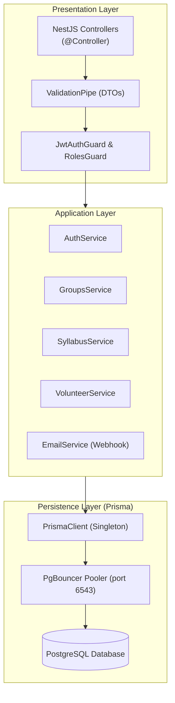

# 🛠️ الملف التقني المتقدم لمهندسي البرمجيات (Senior Developer Technical Dossier)
### منصة باقون التعليمية — Baaqoon System Architecture & Deep Dive
> **الجمهور المستهدف:** كبار المطورين ومهندسي النظم (Senior / Staff / Lead Developers)  
> **الإصدار:** 2.4.0 (Production Core) | **بيئة التشغيل:** Node 20 LTS, PostgreSQL 15+, React 18

---

## 1. المعمارية المعيارية وأنماط التصميم (Architecture & Design Patterns)

تعتمد المنصة معمارية **Clean Modular Monorepo** قائمة على فصل الاهتمامات (Separation of Concerns) مع تطبيق مفاهيم **Domain-Driven Design (DDD)** في الطبقات الخلفية ومبادئ **Feature-Based Architecture** في الطبقات الأمامية.

### 1.1 معمارية الخادم (NestJS 10 Backend Core)
* **Dependency Injection & Inversion of Control (IoC):** كافة الخدمات والمستودعات تحقن عبر مزودات NestJS (`@Injectable()`).
* **Layering Structure:**
  - `Presentation Layer (Controllers)`: استقبال طلبات HTTP، التحقق من صحة المدخلات (`ValidationPipe`), وتطبيق الـ Guards.
  - `Application Layer (Services)`: منطق الأعمال الصافي (Business Logic)، تنسيق المعاملات (`Transactions`), وتجريد قواعد البيانات.
  - `Persistence Layer (Prisma ORM)`: النمذجة العلائقية ومحرك الاستعلامات لـ PostgreSQL.
  - `Cross-Cutting Concerns`: فلاتر الأخطاء العامة (`Global Exception Filter`), حراس الصلاحيات (`RolesGuard`), واعتراض الطلبات (`Interceptors`).



### 1.2 معمارية الواجهة الأمامية (React 18 + TypeScript + Vite)
* **Single Page Application (SPA)** تعتمد `React Router DOM 6` مع معمارية المسارات المتداخلة (`Nested Layout Routing`).
* **State Management:**
  - `useAuthStore (Zustand)`: إدارة الجلسة، الـ Tokens، بيانات المستخدم الحالي، والتبديل بين الأدوار.
  - `Server-State & Mutexing`: اتصالات Axios مع Interceptors لحقن `Authorization: Bearer <token>` وتجديد التوكن عند انتهاء الصلاحية (`401 Interception`).
* **Tree-Shaking & Lazy-Loading:** تجزئة الكود حسب الفضاءات (Student / Teacher / Supervisor / Admin) لتقليل حجم الحزمة الأولى (`Initial Bundle Size`).

---

## 2. محرك البيانات وإدارة اتصالات الـ Pool (PostgreSQL & Prisma)

### 2.1 مخططات قاعدة البيانات المتعددة (`Multi-Schema Strategy`)
لا يتم خلط الجداول في المخطط الافتراضي `public`. تم تنظيم النماذج في `packages/backend/prisma/schema.prisma` عبر ميزة `multiSchema`:

```prisma
datasource db {
  provider = "postgresql"
  url      = env("DATABASE_URL")
  directUrl = env("DIRECT_URL")
  schemas  = ["users", "curriculum", "groups", "scheduling", "assessments", "chat", "notifications", "public"]
}
```

* **`users.users`:** الجدول السيادي لكافة الحسابات (إداريين، معلمين، مشرفين، طلبة).
* **`groups.cohorts` / `groups.cohort_instructors` / `groups.cohort_enrollments`:** محرك الأفواج والتفويج.
* **`curriculum.subjects` / `curriculum.syllabus_distributions` / `curriculum.recorded_lessons`:** المنهاج والخطط التعليمية.
* **`scheduling.sessions` / `scheduling.session_attendances`:** الحصص المجدولة ورصد الحضور والغياب.

### 2.2 إدارة الاتصالات وتفادي اختناق الـ Pool (`EMAXCONNSESSION`)
> [!WARNING]
> **قضية حرجة للمطورين:** عند استخدام `Supabase Connection Pooler` في نمط `Session Mode` (المنفذ `5432` أو `6543`)، يكون الحد الأقصى للاتصالات المتزامنة محدوداً بـ **15 اتصالاً (pool_size: 15)**.

* **المشكلة البرمجية:** تنفيذ عمليات متوازية مفرطة عبر `Promise.all([p.user.count(), p.cohort.count(), ...])` تفتح اتصالات متزامنة متعددة لكل استعلام، مما يُسقط الخادم بخطأ:
  `FATAL: (EMAXCONNSESSION) max clients reached in session mode`.
* **الحل المعماري المعتمد في المنصة:**
  1. الاستعلامات التراكمية في الخدمات يجب أن تُنفذ بتسلسل محكوم (`Sequential await`) أو بدمجها في استعلام واحد مجمّع (`prisma.$transaction`).
  2. ضبط إعدادات `DATABASE_URL` لتضمين معامل اتصال الـ Pooler:  
     `?pgbouncer=true&connection_limit=10&pool_timeout=20`.
  3. استخدام `DIRECT_URL` (المنفذ `5432` المباشر) **فقط** لأمر ترحيل المخططات `prisma migrate deploy` وليس لخدمات الـ Runtime.

---

## 3. خوارزميات الأعمال الحساسة (Critical Core Logic)

### 3.1 خوارزمية تطبيع الهوية واكتشاف التكرارات (`Identity Validator Engine`)
*الملف المصدري:* [`packages/backend/src/modules/auth/application/identity-validator.util.ts`](file:///packages/backend/src/modules/auth/application/identity-validator.util.ts)

لمنع تسجيل نفس المستخدم بصيغ هاتف أو بريد مختلفة:

```typescript
// 1. تطبيع البريد الإلكتروني
export function normalizeEmail(email?: string | null): string | null {
  if (!email) return null;
  return email.trim().toLowerCase();
}

// 2. تطبيع الهاتف واستخراج الذيل الدال (Significant Tail)
export function normalizePhone(phone?: string | null): { normalized: string | null; tail: string | null } {
  if (!phone) return { normalized: null, tail: null };
  
  // إزالة كافة المحارف غير الرقمية مع الاحتفاظ برمز + البادئ
  let cleaned = phone.trim().replace(/[^\d+]/g, '');
  if (cleaned.startsWith('00')) cleaned = '+' + cleaned.slice(2);
  
  // استخراج آخر 8-9 أرقام (لتخطي اختلاف مفاتيح الدول: +970 vs +972 vs 059)
  const digitsOnly = cleaned.replace(/\D/g, '');
  const tail = digitsOnly.length >= 8 ? digitsOnly.slice(-8) : null;
  
  return { normalized: cleaned, tail };
}
```

* **آلية الفحص عند التسجيل والتحديث:**
  1. التحقق من البريد عبر استعلام غير حساس لحالة الأحرف: `mode: 'insensitive'`.
  2. التحقق من الهاتف بمطابقة كاملة ومطابقة ذيلية: `phoneConditions.push({ phone: { endsWith: phoneTail } })`.
  3. استثناء معرّف المستخدم الحالي عند التعديل: `id: { not: currentUserId }`.

---

### 3.2 خوارزمية متابعة المنهاج وتنبيهات التأخر الأكاديمي (`Syllabus Pacing Algorithm`)
*الملف المصدري:* [`packages/backend/src/modules/curriculum/presentation/http/syllabus.controller.ts`](file:///packages/backend/src/modules/curriculum/presentation/http/syllabus.controller.ts)

* **المدخلات:** الخطة الزمنية للمادة (`SyllabusDistribution`) مقسمة حسب الأشهر (`SyllabusMonth.expectedSessionsCount`).
* **المعالجة:**
  $$\text{Actual Sessions} = \sum \text{Sessions with Status 'completed'} \quad \text{for cohort in target month}$$
  $$\Delta = \text{Expected Sessions} - \text{Actual Sessions}$$
* **المخرجات:** إذا كانت $\Delta \ge 2$ (تأخر بحصتين أو أكثر):
  1. يولد النظام سجلاً تحذيرياً في `ActivityLog` من النوع `SUPERVISOR_SYLLABUS_WARNING`.
  2. يرسل إشعاراً فورياً في لوحة تحكم المشرف المختص بالمادة مع شارة تنبيه برتقالية/حمراء.

---

### 3.3 معمارية الدور المزدوج وتغيير السياق الأكاديمي (`Dual-Role Hot-Swapping`)
* **جدول الصلاحيات المتعددة:** `UserRoleAssignment` (`userId`, `role`).
* **المنطق البرمجي في الـ Frontend:**
  ```typescript
  // DashboardLayout.tsx
  const canSwitchTeacherSupervisor = Boolean(
    user?.isDualRole ||
    (Array.isArray(user?.roles) && user.roles.includes('teacher') && user.roles.includes('subject_supervisor'))
  );
  ```
* **تغيير السياق:** لا يتطلب تسجيل خروج أو إعادة طلب JWT Token جديد؛ يتم حفظ السياق النشط في مخزن Zustand (`isInTeacherSpace: boolean`)، وتقوم الواجهة بتبديل الروابط المعروضة ومسارات واجهات البرمجة ديناميكياً.

---

## 4. تكامل المراسلات وتفادي حجب المنافذ (Email Relay & GAS Gateway)

### 4.1 مشكلة خوادم Render السحابية مع منافذ البريد:
* خوادم Render تمنع حركة الخروج (Egress) عبر منافذ SMTP التقليدية (`25`, `465`, `587`).
* استخدام بروتوكول SMTP المباشر يؤدي إلى `ETIMEDOUT` أو `ECONNREFUSED`.

### 4.2 الحل المعماري المنفذ: Google Apps Script Webhook Relay
* تم إنشاء Google Apps Script مربوط بـ Workspace الرسمي لمنصة باقون (`baaqoon@gmail.com`) ونشره كتطبيق ويب (`Web App`) يستقبل طلبات `POST` بصيغة JSON عبر منفذ HTTPS الآمن (`443`).
* **تجريد الإيموجي الصارم (Strict Emoji Stripping):**
  ```typescript
  // email.service.ts
  const stripEmojis = (str: string): string => {
    return str
      .replace(/[\u{1F600}-\u{1F64F}\u{1F300}-\u{1F5FF}\u{1F680}-\u{1F6FF}\u{1F700}-\u{1F77F}\u{1F780}-\u{1F7FF}\u{1F800}-\u{1F8FF}\u{1F900}-\u{1F9FF}\u{1FA00}-\u{1FA6F}\u{1FA70}-\u{1FAFF}\u{2600}-\u{26FF}\u{2700}-\u{27BF}\u{2B50}\u{200D}\u{FE0F}]/gu, '')
      .replace(/\s+/g, ' ')
      .trim();
  };
  ```
  *السبب التقني:* خوادم Google Apps Script وعملاء البريد القديمة تفشل في ترميز محارف 4-byte UTF-8 وتستبدلها بـ `???`، مما يشوه النصوص العربية الرسمية. تم تطبيق الفلتر لضمان نقاء لغوي بنسبة 100%.

---

## 5. فخاخ برمجية وحلولها المعتمدة (Hard-Won Gotchas & Fixes)

| رقم | الفخ البرمجي (Gotcha) | العَرَض الميداني | الحل الهندسي المعتمد في الكود |
| :---: | :--- | :--- | :--- |
| **1** | **CSS Flexbox Text Shrinking Defect** | في شاشات Microsoft Surface والتابلت، خروج زر الإجراء خارج إطار بطاقة التنبيه الأمني (`خارجة اطارها`). | وضع `flex-1 min-w-0` على الحاوية النصية و `break-words` على العناوين، مع إجبار الحاوية على `overflow-hidden`. |
| **2** | **Prisma PostgreSQL Model Mapping** | خطأ `relation "User" does not exist` عند محاولة كتابة استعلامات خام أو استخدام اسم الكيان مباشرة. | جدول المستخدمين معرّف بـ `@@map("users")` في مخطط `users`. يجب استخدام `prisma.user` أو كتابة SQL مع اسم المخطط `users.users`. |
| **3** | **Multiple Incomplete Accounts Collision** | رسالة «البريد الإلكتروني المدخل مستخدم مسبقاً» لأستاذ عند محاولة استكمال بريده. | وجود حساب ثانٍ بنفس الاسم أو الحساب أُنشئ مسبقاً عبر لوحة الإدارة. الحل: دمج الحسابات (`Account Reconciliation`) وتحديث الـ ID في `cohort_instructors`. |
| **4** | **ReCAPTCHA Verification on Mobile Viewports** | فشل تفعيل زر التسجيل على أجهزة الطلبة الضعيفة بسبب تعليق تحميل سكريبت Google Recaptcha. | إضافة مسار `recaptcha-fallback-token` مشروط في البيئات الضعيفة مع التحقق المشدد على الخادم عبر `IP Rate-Limiting`. |

---

## 6. دليل واجهات البرمجة والـ DTOs (API Contract Reference)

### 6.1 مسار المصادقة (Auth Module):
* **`POST /api/auth/login`**
  - **Request Body:** `{ identifier: string, password: string }` (يقبل البريد أو الهاتف).
  - **Response (200):** `{ access_token: string, user: UserDto }`.
* **`POST /api/auth/register`**
  - **Request Body:** `{ firstNameAr, lastNameAr, firstNameEn, lastNameEn, email, phone, nationality, password, primaryRole: 'student', recaptchaToken }`.
  - **Validation:** يتطلب إدخال الحروف اللاتينية والعربية وتطبيع رقم الهاتف الدولي.

### 6.2 مسار إدارة المستخدمين (Users Module):
* **`PATCH /api/users/profile`**
  - **Headers:** `Authorization: Bearer <token>`
  - **Request Body:** `{ email?: string, phone?: string, nationality?: string, firstName?: string, lastName?: string }`
  - **Error (409):** `ConflictException` في حال كان البريد أو ذيل الهاتف مستخدماً بحساب آخر.
* **`POST /api/users/assign-subject`**
  - **Role Required:** `super_admin | admin | subject_supervisor`
  - **Request Body:** `{ teacherId: UUID, subjectId: UUID }`
  - **Effect:** يثبت `supervisedSubjectId` ويفك بوابة الأمان `MandatorySubjectGate`.

### 6.3 مسار المتطوعين (Volunteer Module):
* **`POST /api/volunteer/applications/:id/convert-to-teacher`**
  - **Role Required:** `super_admin | admin`
  - **Request Body:** `{ initialPassword?: string, adminNotes?: string, subjectId?: UUID }`
  - **Transactional Sequence:**
    1. إنشاء حساب في `users.users` وتشفير كلمة المرور بـ Bcrypt (salt: 10).
    2. إنشاء سجل في `users.user_role_assignments` بالدور `teacher`.
    3. تحديث `auth.volunteer_applications` بربط `convertedUserId` وحالة `approved`.
    4. استدعاء `emailService.sendMail` ببيانات الاعتماد الرسمية.

---

## 7. تعليمات التشغيل والبناء المحلي (Local Dev & Build Setup)

### 7.1 تثبيت الاعتماديات والتشغيل:
```bash
# تثبيت الحزم المشتركة على مستوى المونوريبو
npm install

# تشغيل خادم التطوير الخلفي (Port 3000)
cd packages/backend
npm run start:dev

# تشغيل خادم التطوير الأمامي (Port 5173)
cd packages/frontend
npm run dev
```

### 7.2 فحص البناء والتحقق من سلامة الأنواع (Type-Checking):
```bash
# بناء الواجهة والتحقق من الصرامة البرمجية لـ TypeScript
npm --prefix packages/frontend run build

# فحص توافق Prisma Schema وتحديث الـ Client
npm --prefix packages/backend run prisma:generate
```

---
**وثيقة مرجعية مهندسي برمجيات منصة باقون التعليمية — غزة باقية.. والعلم سلاحنا الذي لا يُهزم 🌿**
